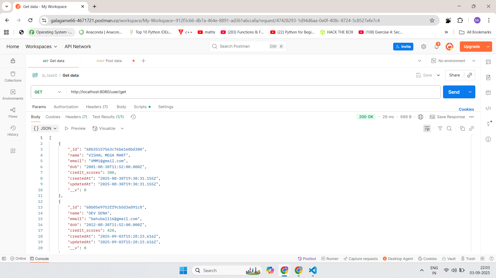
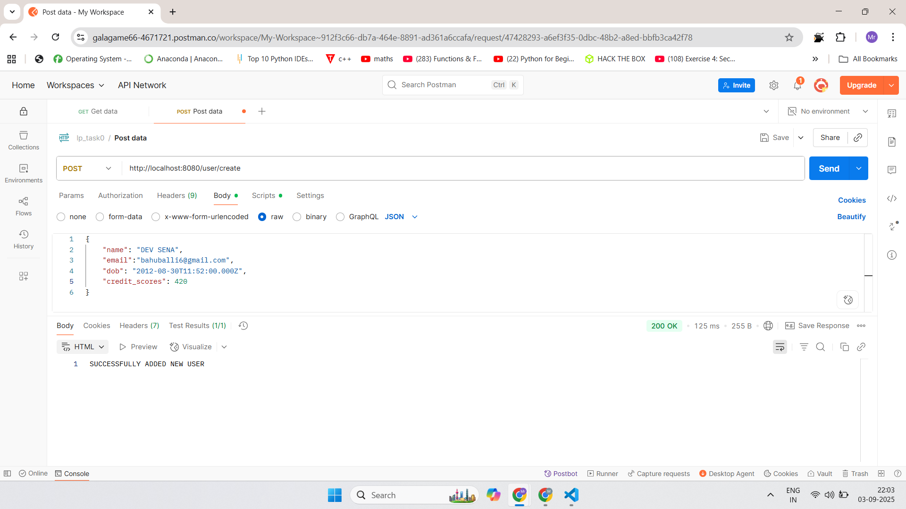
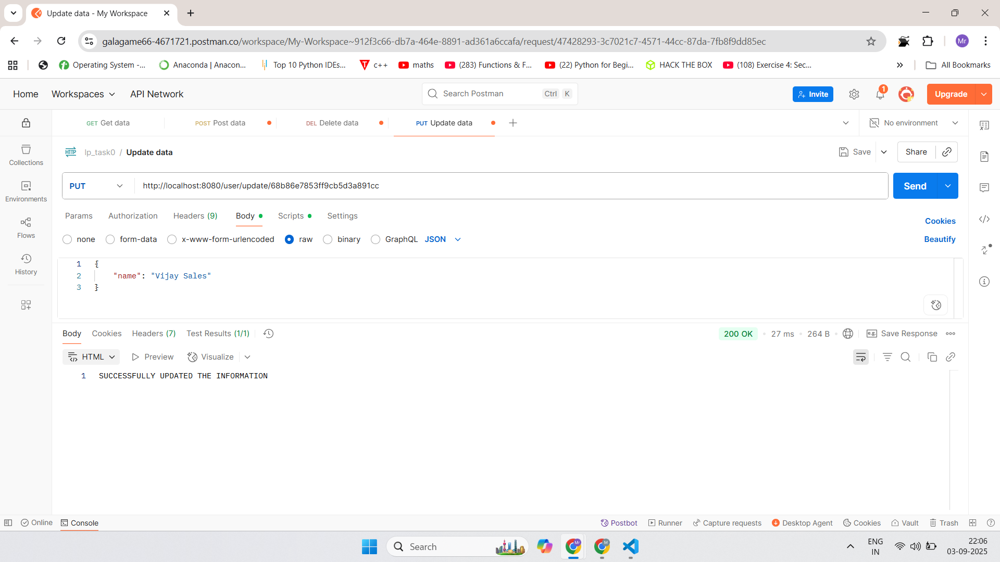
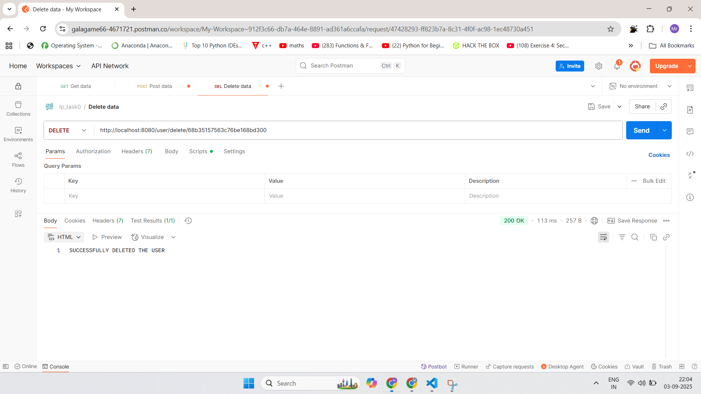

# Lp_unicode

## Elasticsearch in Docker

The client uses `http://localhost:9200` without authentication when no credentials
are configured (for a local container with security disabled). When both
`elasticsearch_username` and `elasticsearch_password` are configured, it uses
basic authentication and defaults to `https://localhost:9200`.
`ELASTICSEARCH_USERNAME` and `ELASTICSEARCH_PASSWORD` are also supported.
Providing only one credential produces a configuration error.

Override the endpoint with `ELASTICSEARCH_URL` (or `elasticsearch_url`), including
the protocol and published Docker port. These variables can be supplied through
the process environment; editing `.env` is not required. Credentials must match
the container's security configuration. Self-signed HTTPS certificates are accepted
on loopback addresses in development; production uses normal certificate validation.

## Authenticated presence

HTTP requests use `Authorization: Bearer <accessToken>`. Socket.IO clients send
the same access token in the handshake, then join using only the document ID:

```js
const socket = io("http://localhost:8080", {
  auth: { token: accessToken }
});
socket.emit("joinDoc", documentId, result => console.log(result));
socket.emit("heartbeat", documentId);
socket.emit("leaveDoc", documentId);
```

Presence identity comes from the verified token; client-supplied user IDs are
ignored. Owners, editors, and viewers can join. Invalid or expired tokens fail
the connection with `connect_error`. Connected sockets disconnect when their
token expires; refresh through `/user/refresh`, set `socket.auth.token` to the
new access token, and reconnect. Rejoin the document after reconnecting.

Document event acknowledgements return `{ ok: true }` or
`{ ok: false, status, message }`. Without an acknowledgement, failures emit
`document:error`. `presence:update` contains `{ documentId, users }`.

Owners revoke both viewing and editing access with
`PATCH /user/document/revokeUserAccess/:doc_id`, authenticated as usual, with
JSON body `{ "user_id": "<target user ID>" }`. The server removes that user's
sockets from the room and emits `document:accessRevoked`. Permission changes
must go through this endpoint for immediate eviction; heartbeats also recheck
access. Presence uses in-memory state and currently targets a single server.

Profile upload and account deletion retain their existing `:id` URLs, but the
ID must match the authenticated user. Access requests retain their existing
`{ doc_id, requests: { type } }` shape; the server sets requester identity and
pending status, and returns an acknowledgement without document contents.

Run permission and session tests with `npm test` (no external services needed).

## Document visibility and updates

`GET /user/get/documents` returns only documents the authenticated user owns or
has viewing/editing access to. The unrestricted `/user/get/Alldocuments` route
has been removed. Search (`POST /user/document/search`, body `{ "query": "text" }`)
filters Elasticsearch by authorized MongoDB document IDs and rechecks permissions
before returning hits. MongoDB authorization failures never fall back to an
unrestricted search.

The chatbot now accepts HTTP JSON `{ "message": "your question" }` at
`POST /user/document/chatbot` and returns `{ "reply": "answer" }`. It loads fresh
authorized document IDs, titles, and contents for each question. It does not
retain previous document context between requests or read from the server terminal.

Generic document updates accept only string `title` and/or `content` fields.
Protected fields, dotted field paths, MongoDB operators, and empty updates return
400. Sharing uses owner-only access routes; restoration uses its dedicated
editor/owner route. `lastEditedBy` is assigned by the server.

GET REQUEST


POST REQUEST


UPDATE REQUEST


DELETE REQUEST 

